# 

Spotify only has one shuffle and you can't control it. This app connects to your Spotify account, shows your playlists with full audio details (BPM, key, energy, mood and more), reorders them with smarter shuffle modes, analyzes them and suggests new songs. It runs locally on your machine and stores nothing.

## Features

- **Full track list**: every playlist shown like in Spotify (title, artists, album, added by, date added, duration) plus release year, BPM, key, energy, danceability, mood, acousticness, instrumentalness, loudness and popularity. Search and sort by any column.
- **30 second previews**: click ▶ on any track. Previews come from Deezer, with the iTunes Search API as a fallback when Deezer doesn't have one.
- **Shuffle modes**: pure random, artist-balanced, artist spacing, smooth BPM transitions, energy curves and mood sequences. Shuffling runs in the browser, so it's instant. Preview the new order, sort it, then overwrite the playlist or save it as a new one.
- **Insights**: total duration, artist diversity, release decades, top artists, top genres, average BPM, mood and audio characteristics.
- **Discover**: suggests songs from artists related to the ones in your playlist and adds the ones you pick.
- **Safe overwrite**: refuses to overwrite playlists that contain local files or podcast episodes, because Spotify can't add them back.

## Where the data comes from

Spotify removed audio features, popularity and recommendations from its API for new apps, so the app combines free public APIs. None of them need an API key.

| Data                                                | Source                                                                              |
| --------------------------------------------------- | ----------------------------------------------------------------------------------- |
| Playlists, tracks, who added them, artist genres    | [Spotify Web API](https://developer.spotify.com/documentation/web-api)              |
| Tempo, key, energy, danceability, mood, loudness... | [ReccoBeats](https://reccobeats.com) (by Spotify track ID)                          |
| BPM fallback and popularity (Deezer rank)           | [Deezer API](https://developers.deezer.com/api) (by ISRC)                           |
| 30 second previews                                  | Deezer, then [iTunes Search API](https://performance-partners.apple.com/search-api) |
| Related artists for Discover                        | Deezer                                                                              |

### How it stays fast

- The track list loads from Spotify and ReccoBeats right away. Deezer details (BPM fallback and popularity) load in the background in batches and fill in the table as they arrive, with progress shown under the playlist title.
- Deezer allows 50 requests every 5 seconds, so its calls go through a rate limiter and are retried instead of failing silently.
- Results from ReccoBeats, Deezer and user names are cached in memory while the server runs, so opening a playlist again is much faster.
- Previews are looked up only when you press play.
- Shuffle and insights are calculated in the browser from the tracks already loaded, with no extra requests.

## Setup

**Requirements:** Node.js 20 or newer and a Spotify account. Spotify requires the app owner to have **Premium** for apps in Development Mode.

### 1. Create a Spotify app

1. Open the [Spotify Developer Dashboard](https://developer.spotify.com/dashboard) and click **Create app**.
2. Fill in any name and description.
3. In **Redirect URIs**, add exactly:

   ```text
   http://127.0.0.1:3000/api/auth/callback
   ```

   Spotify doesn't accept `localhost`, so it must be `127.0.0.1`. There must be no trailing slash.

4. Under **Which API/SDKs are you planning to use?**, check **Web API**, accept the terms and save.
5. Open the app's **Settings** and copy the **Client ID** and **Client secret**.
6. Optional: to let other people sign in, add their Spotify email under **User Management**. Apps in Development Mode accept up to 5 users.

### 2. Configure and run

```bash
npm install
cp .env.example .env
```

Fill in `.env`:

| Variable                | Value                                                                          |
| ----------------------- | ------------------------------------------------------------------------------ |
| `SPOTIFY_CLIENT_ID`     | Client ID from your Spotify app                                                |
| `SPOTIFY_CLIENT_SECRET` | Client secret from your Spotify app                                            |
| `SPOTIFY_REDIRECT_URI`  | `http://127.0.0.1:3000/api/auth/callback` (same value as in the dashboard)     |
| `SESSION_SECRET`        | Random string with at least 32 characters. Generate one with the command below |

```bash
node -e "console.log(require('crypto').randomBytes(64).toString('hex'))"
```

Start the app and open [http://127.0.0.1:3000](http://127.0.0.1:3000):

```bash
npm run dev
```

If you open `localhost:3000` instead, the login redirects you to `127.0.0.1` automatically, because the session cookie has to be on the same host as the Spotify redirect.

`.env` is ignored by git. Never commit it.

### Troubleshooting

| Problem                                           | Fix                                                                                                     |
| ------------------------------------------------- | ------------------------------------------------------------------------------------------------------- |
| `INVALID_CLIENT: Invalid redirect URI` on Spotify | The Redirect URI in the dashboard must be exactly the same as `SPOTIFY_REDIRECT_URI`                    |
| "Security check failed" after login               | Clear cookies for `localhost` and `127.0.0.1` and try again. Don't refresh the callback page            |
| Back on the home page after accepting             | Make sure you use `127.0.0.1:3000`, and that `SESSION_SECRET` didn't change while logging in            |
| 403 errors after login                            | Your Spotify account isn't in the app's **User Management** list, or the app owner doesn't have Premium |
| Some tracks have no audio data                    | ReccoBeats doesn't have every track. BPM falls back to Deezer when possible                             |
| A track shows × on the preview button             | Neither Deezer nor iTunes has a preview for it                                                          |

## Scripts

| Command             | Description                            |
| ------------------- | -------------------------------------- |
| `npm run dev`       | Start the development server           |
| `npm run build`     | Create a production build              |
| `npm run start`     | Serve the production build             |
| `npm run lint`      | Run ESLint                             |
| `npm run typecheck` | Run the TypeScript compiler            |
| `npm run test`      | Run the unit tests                     |
| `npm run check`     | Run lint, typecheck and tests together |

## Project structure

```text
app/
  api/                  Route handlers (thin: auth, validate, call a service)
  dashboard/            Playlist grid
  playlists/[id]/       Playlist page and its tabs (tracks, shuffle, insights, discover)
components/ui/          Reusable UI components
lib/
  auth/                 Session, PKCE and login errors
  config/               Validated environment variables
  domain/               Core types and constants, no framework code
  engines/              Pure algorithms: shuffle, insights, discovery
  services/             Use cases that combine Spotify and the public APIs
  spotify/              Spotify API client, raw types and mappers
  reccobeats/           Audio features client
  deezer/               BPM, popularity, previews and related artists client
  itunes/               Preview fallback client
  hooks/                React hooks, including background loading of Deezer details
  http/                 Error handling, request origin and security headers
  api/                  Typed client used by the browser
proxy.ts                Auth guard and security headers
```

## API

| Method | Route                                | Description                                       |
| ------ | ------------------------------------ | ------------------------------------------------- |
| GET    | `/api/playlists`                     | Playlists you own or collaborate on               |
| POST   | `/api/playlists`                     | Create a playlist with tracks                     |
| GET    | `/api/playlists/:id`                 | Playlist details                                  |
| GET    | `/api/playlists/:id/tracks`          | Tracks in original order with audio features      |
| PUT    | `/api/playlists/:id/tracks`          | Overwrite the track order                         |
| POST   | `/api/playlists/:id/tracks`          | Add tracks                                        |
| GET    | `/api/playlists/:id/recommendations` | New song suggestions                              |
| POST   | `/api/tracks/details`                | BPM and popularity from Deezer for up to 50 ISRCs |
| GET    | `/api/tracks/preview`                | Preview URL for one track (Deezer, then iTunes)   |
| GET    | `/api/artists/genres`                | Genres for up to 20 artists                       |

## Security

- Tokens never reach the browser: they live in an encrypted, `httpOnly` session cookie
- OAuth uses PKCE and a random `state` parameter against code interception and CSRF
- Every request body and query string is validated with zod
- Strict security headers, including a Content Security Policy
- No database: nothing about your account or listening history is stored

## License

[MIT](LICENSE)
